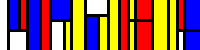
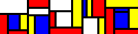
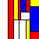
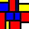
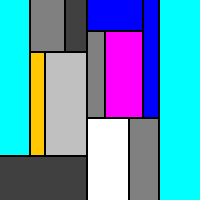
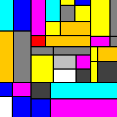

# Rapport — générateur de peintures abstraites

## Objectif et méthodes

Le programme produit des compositions rectangulaires colorées et séparées par
des lignes noires. Trois méthodes de génération et un mode de reconstruction
sont disponibles :

1. **Arbre binaire avec données fournies** : lit les proportions et couleurs
   d'un fichier texte, puis choisit les feuilles à découper avec un tas binaire.
2. **Arbre binaire aléatoire** : génère les lignes, couleurs et paramètres de
   découpe avant d'appliquer le même modèle binaire.
3. **RQuadtree aléatoire** : génère les données de façon aléatoire et découpe
   chaque feuille en quatre régions à chaque division.
4. **Reconstruction depuis un fichier texte** : la stratégie 0 lit le texte
   sérialisé par l'une des autres stratégies et produit l'image correspondante.

La largeur, la hauteur, le nombre maximal de feuilles divisées, la dimension
minimale et l'épaisseur des séparations sont configurables. Les deux modes
aléatoires proposent des paramètres automatiques ou fournis par l'utilisateur.

## Résultats

Les premières figures sont les sorties de référence de la méthode 1, pour
différentes tailles et variantes :

| Dimensions / variante | Résultat |
|---|---|
| 200 × 50, variante A |  |
| 200 × 50, variante B |  |
| 50 × 50, variante A |  |
| 50 × 50, variante B |  |

Exemples obtenus avec les deux générateurs aléatoires (200 × 200, 12 divisions,
dimension minimale 10, largeur de ligne 2, variante A) :

| Méthode | Résultat |
|---|---|
| Arbre binaire aléatoire |  |
| RQuadtree aléatoire |  |

Chaque exécution des méthodes 2 et 3 peut produire une composition différente ;
les images ci-dessus sont des exemples enregistrés. Les commandes de lancement
sont décrites dans le [README](README.md). Les méthodes 1 à 3 sauvegardent
également l'arbre sérialisé pour permettre sa reconstruction par la stratégie 0.

## Conversion arbre ↔ texte

`Tree2D.toString()` et `RQuadtree.toString()` représentent l'arbre entier,
dimensions comprises. Les constructeurs `Tree2D(String)` et
`RQuadtree(String)` reconstruisent la structure, les divisions et les couleurs.
Un aller-retour conserve donc la représentation :

```java
String text = tree.toString();
Tree2D restored = new Tree2D(text);
assert text.equals(restored.toString());
```

Des tests couvrent les deux arbres, les quatre quadrants du RQuadtree et le
rejet d'une division invalide.
